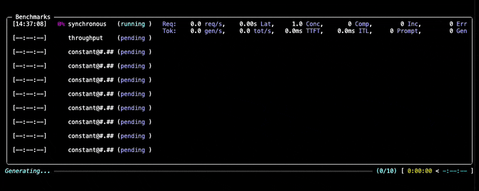

# 벤치마크 실행

1. [GuideLLM 설치](install.md)
2. GuideLLM은 두 가지 방식으로 실행할 수 있습니다:
   1. 실행 중인 OpenAI 호환 LLM 서버 대상으로 실행
      - 가장 일반적인 방법입니다.
   2. vLLM Python 백엔드를 사용하여 동일한 프로세스에서 vLLM과 함께 실행
      - GuideLLM 실행 방법뿐 아니라 vLLM 설정 방법도 알아야 합니다.
      - 별도의 서버가 필요하지 않아 실행 및 관리가 간편해집니다.

> [!NOTE]\
> 백엔드별 입력 항목을 제외하면, 이 가이드의 모든 내용은 두 백엔드에 동일하게 적용됩니다.
>
> 이 가이드는 OpenAI 호환 LLM 서버와 함께 OpenAI HTTP 백엔드 사용을 전제로 합니다. vLLM Python 백엔드 사용 방법은 [vLLM Python 백엔드(영문)](../../guides/vllm-python-backend.md)를 참고하세요.

[서버 시작](server.md) 이후에는 벤치마크를 실행하여 배포한 LLM의 성능을 평가할 수 있습니다.

## CLI 옵션 형식

GuideLLM CLI는 레지스트리 기반의 공통 형식으로 옵션을 제공합니다. `kind=<type>`으로 등록된 구현체를 선택하고, key=value 쌍으로 파라미터를 설정합니다:

```bash
guidellm run --<option> kind=<TYPE>,key=value,...
```

중첩 구조가 없는 설정에는 쉼표로 구분한 key=value 쌍을 사용하세요(예: `--data kind=synthetic_text,prompt_tokens=256,output_tokens=128`). 값에 중첩 구조가 포함되어 있다면 JSON 또는 YAML로 직렬화한 문자열을 사용하세요(예: `--data '{"kind":"huggingface","source":"org/dataset","loader_kwargs":{"split":"test"}}'`). 동일한 옵션 안에서 인라인 key=value 형식과 JSON/YAML 형식을 혼용하지 마세요. 일부 옵션은 여러 번 지정하여 여러 값을 전달할 수 있습니다(예: `--data`나 `--constraint` 여러 번 지정 가능).

`--config`(별칭: `--scenario`, `-c`)를 사용하면 저장된 시나리오(YAML 또는 JSON 파일)를 불러올 수 있습니다. CLI 옵션은 시나리오에 설정된 값보다 우선 적용됩니다.

### 기본 예제

기본 설정으로 로컬 vLLM 서버를 대상으로 벤치마크를 실행하려면 다음 명령어를 사용하세요:

```bash
guidellm run \
  --backend kind=openai_http,target=http://localhost:8000 \
  --data kind=synthetic_text,prompt_tokens=256,output_tokens=128 \
  --constraint kind=max_duration,seconds=60
```

이 명령어는 다음과 같이 동작합니다:

- `http://localhost:8000`에서 실행 중인 vLLM 서버에 연결
- 요청당 프롬프트 토큰 256개와 출력 토큰 128개로 구성된 합성 데이터 사용
- 서버에서 사용 가능한 모델 자동 확인
- `sweep` 프로파일(기본값)을 실행하여 최적의 성능 지점 탐색
- 각 실행 구성을 60초 동안 실행한 후 종료

벤치마크 실행 중에는 다음과 비슷한 진행 상황이 표시됩니다:



데이터셋 옵션에 대한 자세한 내용은 [데이터셋 문서(영문)](../../guides/datasets.md)를, 백엔드 설정에 대한 자세한 내용은 [백엔드 문서(영문)](../../guides/backends.md)를 참고하세요.

## 벤치마크 옵션 이해하기

GuideLLM은 벤치마크를 원하는 대로 구성할 수 있도록 다양한 설정 옵션을 제공합니다. 알아두어야 할 주요 파라미터는 다음과 같습니다:

### 핵심 파라미터

| 파라미터        | 설명                                  | 예제                                                                                       |
| --------------- | ------------------------------------- | ------------------------------------------------------------------------------------------ |
| `--backend`     | 백엔드 유형 및 연결 설정              | `--backend kind=openai_http,target=http://localhost:8000,model=Meta-Llama-3.1-8B-Instruct` |
| `--data`        | 데이터 유형 및 설정                   | `--data kind=synthetic_text,prompt_tokens=256,output_tokens=128`                           |
| `--profile`     | 벤치마크 프로파일 유형 및 파라미터    | `--profile kind=sweep,sweep_size=10`                                                       |
| `--constraint`  | 실행 제한 (여러 번 지정 가능)         | `--constraint kind=max_requests,count=1000`                                                |
| `--seed`        | 재현성을 위한 난수 시드               | `--seed kind=static,value=42`                                                              |
| `--data-loader` | 샘플 수 및 loader 설정                | `--data-loader kind=pytorch,samples=1000`                                                  |
| `--output`      | 출력 형식 및 경로 (여러 번 지정 가능) | `--output kind=json,path=results/benchmark.json`                                           |
| `--tokenizer`   | 토큰 수 계산에 사용할 토크나이저      | `--tokenizer kind=huggingface_auto,model=gpt2`                                             |

### 난수 시드 (`--seed`)

난수 시드는 합성 데이터 생성이나 Poisson 방식의 요청 스케줄링 등 GuideLLM에서 무작위성이 필요한 모든 작업에 사용됩니다. 기본적으로 고정된 값을 사용하므로, 동일한 인자로 GuideLLM을 다시 실행하면 동일한 결과를 얻을 수 있습니다:

```bash
--seed kind=static,value=42
```

### 제약 조건 (`--constraint`)

제약 조건은 프로파일에 포함된 각 실행 구성의 종료 시점을 제어합니다. 하나 이상의 `--constraint` 옵션을 추가하세요. 제약 조건은 프로파일의 각 실행 구성에 개별적으로 적용됩니다. 여러 실행 구성을 포함하는 프로파일에는 `sweep`과 주요 파라미터가 리스트로 지정된 프로파일이 있습니다(예: `concurrent`에서 `{"streams":[10,20]}`로 지정한 경우).

| 제약 조건 유형          | 설정 파라미터     | 예제                                                             |
| ----------------------- | ----------------- | ---------------------------------------------------------------- |
| `max_duration`          | `seconds`         | `--constraint kind=max_duration,seconds=30`                      |
| `max_requests`          | `count`           | `--constraint kind=max_requests,count=1000`                      |
| `min_requests`          | `count`           | `--constraint kind=min_requests,count=1000`                      |
| `max_errors`            | `count`           | `--constraint kind=max_errors,count=10`                          |
| `max_error_rate`        | `rate`, `window`  | `--constraint kind=max_error_rate,rate=0.05,window=10`           |
| `max_global_error_rate` | `rate`, `minimum` | `--constraint kind=max_global_error_rate,rate=0.05,minimum=1000` |
| `over_saturation`       | 감지 파라미터     | `--constraint kind=over_saturation,min_seconds=30,mode=enforce`  |

예를 들어, `--constraint kind=max_requests,count=1000`을 `--profile kind=sweep`과 함께 사용하면 Sweep의 각 실행 구성(동기식, 처리량, 중간 요청률)에 대해 최대 1000개의 요청을 실행합니다. `--constraint kind=min_requests,count=1000`은 `max_requests`와 비슷하지만, 요청 1000개가 처리될 때까지 큐에 요청을 계속 추가하여 요청률 기반 벤치마크의 종료 시점에 처리량이 감소하는 현상을 방지합니다. `--constraint kind=max_duration,seconds=30`을 `--profile '{"kind":"concurrent","streams":[10,20]}'`과 함께 사용하면 동시 스트림 10개로 30초 동안 실행한 다음, 동시 스트림 20개로 30초 동안 실행합니다.

과포화 제약 조건에 대한 자세한 내용은 [과포화 시 중단(영문)](../../guides/over_saturation_stopping.md)을 참고하세요.

### 하위 벤치마크(실행 구성별) 제약 조건

`sweep` 프로파일을 사용하거나, `async`/`constant`/`poisson` 프로파일에서 여러 `rate` 값을 지정하거나, `concurrent` 프로파일에서 여러 `streams` 값을 지정하면 하나의 프로파일 안에서 여러 "벤치마크 실행 구성"을 실행하게 됩니다. GuideLLM에서는 `--override` 옵션을 사용하여 제약 조건의 제어 파라미터를 실행 구성별로 다르게 지정할 수 있습니다. 예를 들어, `--profile kind=sweep,sweep_size=5 --constraint kind=max_duration,seconds=30`은 5개의 실행 구성(동기식, 처리량 및 중간 단계별 고정 요청률을 적용한 구성 3개)을 각각 30초 동안 실행합니다. 여기에 `--override constraint[0].seconds 10,20,10,15,20`을 사용하면 동기식 구성은 10초, 처리량 구성은 20초, 중간 고정 요청률을 적용한 구성 3개는 각각 10초, 15초, 20초 동안 실행됩니다. `--override constraint[0].seconds 10,20,10`처럼 값을 더 적게 지정하면, 마지막 값인 10초가 세 고정 요청률 구성에 모두 적용됩니다.

### 벤치마크 프로파일 (`--profile`)

GuideLLM은 아래에서 자세히 설명하는 여러 벤치마크 프로파일을 지원합니다. 프로파일별 파라미터는 동일한 설정 문자열에서 `kind=<type>` 뒤에 지정합니다.

#### 동기식 프로파일

요청을 한 번에 하나씩 순차적으로 실행합니다.

```bash
guidellm run --profile kind=synchronous
```

| 프로파일 파라미터 | 설명                 | 예제 |
| ----------------- | -------------------- | ---- |
| —                 | 요청률 파라미터 없음 |      |

#### 처리량 프로파일

요청을 지속적으로 병렬 실행하여 서버의 최대 처리량을 탐색합니다.

```bash
guidellm run --profile kind=throughput,max_concurrency=10
```

| 프로파일 파라미터 | 설명                                              | 예제                                                              |
| ----------------- | ------------------------------------------------- | ----------------------------------------------------------------- |
| `max_concurrency` | 동시 요청 스트림 수                               | `--profile kind=throughput,max_concurrency=10`                    |
| `rampup_duration` | 최대 처리량까지 부하를 점진적으로 높이는 시간(초) | `--profile kind=throughput,max_concurrency=10,rampup_duration=10` |

#### 동시 실행 프로파일

고정된 수의 요청 스트림을 병렬로 실행합니다.

```bash
guidellm run --profile kind=concurrent,streams=10
```

| 프로파일 파라미터 | 설명                                      | 예제                                                                                              |
| ----------------- | ----------------------------------------- | ------------------------------------------------------------------------------------------------- |
| `streams`         | 유지할 동시 스트림 수; 리스트로 지정 가능 | `--profile kind=concurrent,streams=10` 또는 `--profile '{"kind":"concurrent","streams":[16,32]}'` |
| `rampup_duration` | 초기 요청을 분산하여 전송하는 시간(초)    | `--profile kind=concurrent,streams=10,rampup_duration=10`                                         |
| `max_concurrency` | 스케줄링할 최대 동시 요청 수              | `--profile kind=concurrent,streams=10,max_concurrency=10`                                         |

`--override` 옵션으로 스트림 수를 리스트로 지정하면, 서로 다른 스트림 수를 사용하는 여러 동시 실행 구성(하위 벤치마크)을 실행할 수 있습니다. 예를 들어, `--profile kind=concurrent --override profile.streams 10,20,30`은 스트림 수가 각각 10개, 20개, 30개인 동시 실행 구성을 실행합니다.

#### Knee 프로파일

초기에 여러 동시 스트림 수에서 성능을 측정하고, 출력 처리량의 증가 폭이 작아지기 시작하는 지점을 추정합니다. `adaptive=true`로 설정하면 추정 지점 주변의 여러 지점을 한 차례 더 측정합니다. 이러한 적응형 추가 측정은 기본적으로 비활성화되어 있습니다.

```bash
guidellm run \
  --profile '{"kind":"knee","initial_streams":[1,5,10,20,40,80,160],"adaptive":true,"points_each_side":5,"max_step":3}'
```

이 프로파일은 두 단계 모두 동시 실행 구성을 사용하며, 초기 분석 결과, 적응형 측정 계획, 최종 분석 결과를 보고서의 `conclusions` 리스트에 저장합니다. 설정 및 계산 방식에 대한 자세한 내용은 [Knee 프로파일 가이드(영문)](../../guides/knee_detection.md)를 참고하세요.

초기 동시 스트림 수를 일정한 간격으로 설정하려면 `--profile '{"kind":"knee","min_streams":1,"max_streams":9,"count":5}'`를 사용하세요. 각 측정 지점의 동시 스트림 수를 직접 지정하려면 `initial_streams`를 사용하세요.

#### 고정 요청률 프로파일

고정된 초당 요청 수에 맞춰 비동기 요청을 전송합니다.

(프로파일 이름 `async`와 `constant`는 같은 프로파일을 가리키는 별칭입니다.)

```bash
guidellm run --profile '{"kind":"constant","rate":[16,32]}'
```

| 프로파일 파라미터 | 설명                                                 | 예제                                                                                    |
| ----------------- | ---------------------------------------------------- | --------------------------------------------------------------------------------------- |
| `rate`            | 초당 요청 수; 리스트로 지정 가능                     | `--profile kind=constant,rate=10` 또는 `--profile '{"kind":"constant","rate":[16,32]}'` |
| `rampup_duration` | 요청률을 0에서 목표값까지 선형적으로 높이는 시간(초) | `--profile kind=constant,rate=10,rampup_duration=10`                                    |
| `max_concurrency` | 스케줄링할 최대 동시 요청 수                         | `--profile kind=constant,rate=10,max_concurrency=32`                                    |

`--override` 옵션으로 요청률을 리스트로 지정하면, 서로 다른 요청률을 사용하는 여러 실행 구성(하위 벤치마크)을 실행할 수 있습니다. 예를 들어, `--profile kind=constant --override profile.rate 10,20,30`은 초당 요청 수가 각각 10개, 20개, 30개인 고정 요청률 실행 구성을 실행합니다.

#### Poisson 프로파일

지정한 목표 요청률을 기준으로 Poisson 분포에 따라 요청률을 변화시키며 비동기 요청을 전송합니다. 이러한 확률적 패턴은 실제 환경의 트래픽 패턴을 보다 현실적으로 재현하는 데 유용합니다.

```bash
guidellm run --profile kind=poisson,rate=16 --seed kind=static,value=42
```

| 프로파일 파라미터 | 설명                         | 예제                                                                                  |
| ----------------- | ---------------------------- | ------------------------------------------------------------------------------------- |
| `rate`            | 목표 초당 요청 수(하나 이상) | `--profile kind=poisson,rate=10` 또는 `--profile '{"kind":"poisson","rate":[10,20]}'` |
| `max_concurrency` | 스케줄링할 최대 동시 요청 수 | `--profile kind=poisson,rate=10,max_concurrency=32`                                   |

여러 요청률을 지정하고 `stopping_scope="all"`이 설정된 제약 조건(예: 과포화 또는 오류율 제한)을 사용하면, 해당 제약 조건으로 실행이 중단될 때 목록에 남은 모든 요청률을 건너뜁니다. 더 높은(부하가 큰) 요청률만 건너뛰도록 요청률을 오름차순으로 지정하는 것이 좋습니다. 오름차순이 아니라면 중단이 발생한 요청률 뒤에 있는 더 낮은(부하가 작은) 요청률도 건너뜁니다.

Poisson 스케줄링의 재현성을 확보하려면 `--seed kind=static,value=42`를 사용하세요.

`--override` 옵션으로 요청률을 리스트로 지정하면, 서로 다른 요청률을 사용하는 여러 Poisson 실행 구성(하위 벤치마크)을 실행할 수 있습니다. 예를 들어, `--profile kind=poisson --override profile.rate 10,20,30`은 초당 요청 수가 각각 10개, 20개, 30개인 Poisson 실행 구성을 실행합니다.

#### Sweep 프로파일

Sweep 프로파일은 일련의 벤치마크 실행 구성을 순서대로 적용하여 주어진 모델과 데이터에 대한 최적의 성능 지점을 찾습니다.

1. `synchronous` 실행 구성으로 기준 요청률을 측정합니다.
2. 이어서 `throughput` 실행 구성으로 최대 처리량을 확인합니다.
3. 마지막으로 기준 요청률과 최대 처리량 사이에서 계산한 중간 요청률을 적용하여 여러 비동기 실행 구성을 실행합니다(중간 요청률을 적용하는 실행 구성의 수는 `sweep_size`에서 2를 뺀 값). 비동기 실행 구성의 유형은 프로파일 파라미터인 `strategy_type`으로 지정하며, 기본값은 `constant`입니다. 비동기 실행 단계에서 `stopping_scope="all"`로 설정된 제약 조건이 특정 요청률에서 충족되면 나머지 요청률의 실행은 건너뜁니다.

예를 들어, 실행 구성 10개, 요청률 증가 시간 10초, 비동기 실행 구성 유형 `poisson`으로 Sweep 프로파일을 실행하려면 다음과 같이 설정합니다:

```bash
guidellm run --profile kind=sweep,sweep_size=10,rampup_duration=10,strategy_type=poisson
```

| 프로파일 파라미터 | 설명                                                                    | 예제                                                    |
| ----------------- | ----------------------------------------------------------------------- | ------------------------------------------------------- |
| `sweep_size`      | Sweep에 포함할 실행 구성의 수(동기식 및 처리량 실행 구성 포함)          | `--profile kind=sweep,sweep_size=10`                    |
| `rampup_duration` | 처리량 및 고정 요청률 실행 단계에서 요청률을 점진적으로 높이는 시간(초) | `--profile kind=sweep,sweep_size=10,rampup_duration=10` |
| `strategy_type`   | 중간 요청률을 적용하는 단계의 실행 구성 유형(`constant` 또는 `poisson`) | `--profile kind=sweep,strategy_type=poisson`            |
| `max_concurrency` | 스케줄링할 최대 동시 요청 수                                            | `--profile kind=sweep,max_concurrency=10`               |

#### Replay 프로파일

Trace 파일 데이터셋의 타임스탬프에 따라 trace 이벤트를 재생합니다. 데이터 설정 방법은 아래의 [Trace 재생 벤치마킹](#trace-replay-benchmarking)을 참고하세요.

```bash
guidellm run --profile kind=replay,time_scale=1.0
```

| 프로파일 파라미터 | 설명                                                                                                                                         | 예제                                            |
| ----------------- | -------------------------------------------------------------------------------------------------------------------------------------------- | ----------------------------------------------- |
| `time_scale`      | Trace 이벤트 사이의 시간 간격에 적용할 배율                                                                                                  | `--profile kind=replay,time_scale=2.0`          |
| `schedule_turn`   | `idle_gap`(기본값)은 기록된 각 요청의 소요 시간 이후에 이어지는 유휴 간격을 유지합니다. `timestamp`는 각 trace 타임스탬프에 맞춰 실행합니다. | `--profile kind=replay,schedule_turn=timestamp` |
| `prefetch`        | 실행 시간 측정을 시작하기 전에 미리 불러올 요청 수. 기본값은 0(미리 불러오지 않음)                                                           | `--profile kind=replay,prefetch=all`            |

대기 시간의 상한과 데이터에 적용할 `time_scale`은 `--data`에서 설정합니다. 프로파일의 `time_scale`은 이러한 설정에 따라 데이터셋의 타임스탬프가 생성된 후 스케줄러에서 적용되므로, 서로 다른 시간 배율로 여러 번 실행할 수 있습니다.

`schedule_turn=idle_gap`(기본값)은 기록된 요청 소요 시간 이후에 이어지는 간격을 유지합니다. 예를 들어, 요청의 기록된 소요 시간이 1초이고 다음 요청의 타임스탬프가 현재 요청보다 5초 뒤라면, 현재 요청이 실제로 완료된 시점에서 4초 후에 다음 요청을 시작합니다. 요청이 늦게 시작되거나 오래 걸리면 이후의 모든 요청 일정도 함께 밀립니다. Trace에 소요 시간 열이 없으면 loader가 경고를 한 번 기록하고 각 요청의 기록상 소요 시간을 0으로 간주합니다. 따라서 같은 예시에서는 현재 요청이 완료된 시점에서 5초 후에 다음 요청을 시작합니다. 소요 시간 열의 이름은 `--data`의 `duration_column`으로 설정하며, 기본값은 `duration`입니다. `schedule_turn=timestamp`는 각 요청을 trace에 기록된 시각에 실행하며, 이전 턴이 아직 진행 중인 경우에만 해당 요청을 대기시킵니다.

## 데이터 옵션

### 합성 데이터 옵션

합성 데이터를 사용하려면 `synthetic_text` 데이터 유형과 원하는 파라미터를 지정하세요. 주요 옵션은 다음과 같습니다:

- `prompt_tokens`: 프롬프트의 평균 토큰 수(필수)
- `output_tokens`: 출력의 평균 토큰 수(선택 사항; 임베딩처럼 출력 토큰을 생성하지 않는 엔드포인트에서는 생략)

예를 들어, 프롬프트 길이 100토큰, 출력 길이 50토큰으로 벤치마크를 실행하려면 다음과 같이 설정합니다:

```bash
guidellm run \
  --backend kind=openai_http,target=http://localhost:8000 \
  --data kind=synthetic_text,prompt_tokens=100,output_tokens=50 \
  --profile kind=constant,rate=5
```

표준편차, 최솟값, 최댓값 등의 추가 파라미터로 합성 데이터 생성을 조정할 수 있습니다. 자세한 내용은 [데이터셋 문서의 합성 데이터 항목(영문)](../../guides/datasets.md#synthetic-data)을 참고하세요.

### Trace 재생 벤치마킹 {#trace-replay-benchmarking}

실제 환경과 유사한 부하 테스트를 수행하려면 각 행의 타임스탬프와 토큰 길이를 사용하여 trace 이벤트를 재생하세요. Trace 데이터는 지원되는 [Trace 파일 형식(영문)](../../guides/trace_replay.md#supported-formats)을 사용하며, `--data`의 중첩된 `source` 설정을 통해 로컬 파일이나 HuggingFace 데이터셋에서 불러옵니다. 타임스탬프는 절대 시각 또는 단조 시계 기준의 값일 수 있습니다. GuideLLM은 타임스탬프를 정렬하고 첫 번째 이벤트를 기준으로 한 상대 시간으로 변환한 후 요청을 스케줄링합니다:

```json
{"timestamp": 1234500.0, "input_length": 256, "output_length": 128}
{"timestamp": 1234500.5, "input_length": 512, "output_length": 64}
```

이 예시에서 두 번째 요청은 첫 번째 요청으로부터 0.5초 후에 실행되도록 예약됩니다.

`replay` 프로파일로 실행합니다:

```bash
guidellm run \
  --backend kind=openai_http,target=http://localhost:8000 \
  --data kind=trace_synthetic,source.kind=json_file,source.path=path/to/trace.jsonl,time_scale=1.0 \
  --profile kind=replay,time_scale=0.5
```

데이터 파라미터인 `time_scale`은 대기 시간 및 패킹 제한이 적용된 후 trace 이벤트 사이의 시간 간격에 배율을 적용합니다. `1.0`은 원래 타이밍을 유지하고, `2.0`은 간격을 두 배로 늘려 전체 실행 시간이 두 배가 되며, `0.5`는 간격을 절반으로 줄여 두 배 빠르게 실행합니다. 대기 시간 제한(`max_wait`, `max_session_wait`, `min_concurrent_sessions`)은 `time_scale` 적용 전에 원본 trace의 시간(초)을 기준으로 적용됩니다.

`min_concurrent_sessions`로 병렬성을 높일 수 있습니다. 패킹된 데이터셋이 벤치마크 전체 실행 시간 동안 해당 부하를 유지하기에 충분하지 않으면 `copies`를 사용하세요. 기본 설정(`copy_offset=1`)에서 `copies`는 패킹된 전체 trace를 순차적으로 반복 재생합니다. 다음 재생은 이전 재생의 마지막 요청이 예약된 시점에 시작합니다. `copy_offset`을 사용하면 이전 재생 구간의 길이를 기준으로 복사본을 겹치게 하거나 복사본 사이에 간격을 둘 수 있습니다. 합성 데이터 trace는 복사본마다 합성 데이터 생성에 사용하는 salt 값을 바꿔 각 복사본의 대화가 캐시에서 서로 구분되도록 합니다.

사용 사례에 맞게 병렬성을 높일지, 요청 타이밍을 조정할지 신중하게 선택하세요. 병렬성을 높이면 동시에 실행되는 요청이 늘어나고, 캐시 항목이 제거되어 벤치마크에 영향을 줄 가능성도 커집니다.

`--constraint kind=max_duration,seconds=<n>`은 새 요청의 시작뿐 아니라 진행 중인 대기 작업도 중단합니다. 지정한 시간이 경과하면 이후의 재생 타임스탬프까지 대기 중인 작업자도 취소됩니다.

GuideLLM은 타임스탬프 순서대로 trace 행을 스케줄링합니다. 불러와서 재생할 trace 행의 수를 제한하려면 `--data-loader kind=pytorch,samples=1000`을 사용하세요. `--constraint kind=max_requests,count=1000`은 실행 중 요청 완료 수를 기준으로 종료하는 제약 조건이며, trace 데이터셋 자체를 잘라내지는 않습니다.

요청 그래프가 구성되기 전에 요청의 실행 예정 시각이 도래하는 경우, replay 프로파일의 `prefetch`를 설정하세요. `0`(기본값)은 요청을 미리 불러오지 않고, 실행 중 요청이 필요해질 때 불러옵니다. 양의 정수를 지정하면 해당 개수만큼 요청 노드를 미리 불러옵니다. `start`는 실행 구성에 시작 시 동시 실행 수가 정의되어 있으면 그 수만큼 미리 불러옵니다. `all`은 크기가 유한한 데이터셋의 모든 요청을 미리 불러옵니다. WEKA trace에는 일반적으로 `prefetch=all`을 사용하세요.

모든 형식은 기본적으로 "timestamp", "input_length", "output_length" 열을 찾습니다. Trace에서 다른 열 이름을 사용한다면 데이터 설정에 `timestamp_column`, `prompt_tokens_column`, `output_tokens_column`을 포함하세요:

```bash
guidellm run \
  --backend kind=openai_http,target=http://localhost:8000 \
  --data kind=trace_synthetic,source.kind=json_file,source.path=replay.jsonl,timestamp_column=timestamp,prompt_tokens_column=input_length,output_tokens_column=output_length \
  --profile kind=replay
```

이 기능은 특정 형식에서 요구하는 열에도 적용됩니다. 이러한 추가 열과 형식별 인자에 대한 설명은 [Trace 파일 형식 문서(영문)](../../guides/trace_replay.md)를 참고하세요.

### 실제 데이터 사용하기

합성 데이터는 빠른 테스트에 편리하지만, 실제 데이터로도 벤치마크를 실행할 수 있습니다:

```bash
guidellm run \
  --backend kind=openai_http,target=http://localhost:8000 \
  --data kind=json_file,path=/path/to/your/dataset.json \
  --profile kind=constant,rate=5
```

HuggingFace의 데이터셋도 사용할 수 있습니다:

```bash
guidellm run \
  --backend kind=openai_http,target=http://localhost:8000 \
  --data kind=huggingface,source=garage-bAInd/Open-Platypus \
  --profile kind=constant,rate=5
```

## 출력 옵션

기본적으로 벤치마크 결과는 `benchmarks.json`과 `benchmarks.csv`에 저장됩니다. `--output`을 지정하면 기본 설정 대신 지정한 출력 설정을 사용합니다. 출력 형식을 선택하는 예시는 [출력 설정(영문)](../../guides/outputs.md#cli-output-configuration)을, 기본 디렉터리와 사용자 지정 경로에 대한 내용은 [파일 출력 설정(영문)](../../guides/outputs.md#configuring-file-outputs)을 참고하세요.

### 진행 상황 logging

벤치마크 진행 상황은 비대화형 셸에서도 INFO 수준으로 자동 기록됩니다. 별도의 진행 상황 옵션은 필요하지 않습니다. 각 실행 구성의 시작과 완료, 주기적인 통계(갱신 시 최대 10초에 한 번)가 로그에 기록됩니다. 로그에는 경과 시간, 성공한 요청 수, 오류가 발생한 요청 수, 완료되지 않은 요청 수, 요청 및 출력 토큰 처리량이 포함됩니다. 진행 상황 갱신은 스케줄러 콜백에 따라 이루어지며, 실행이 정체된 상태에서 별도로 주기적인 상태 신호를 보내지는 않습니다.

Rich 진행 상황 표시는 logging과 함께 계속 작동합니다. `--disable-console`과 `--disable-console-interactive`는 화면 표시를 제어하며, logging에는 영향을 주지 않습니다. 어떤 로그가 출력되는지는 기존 로거 수준 설정에 따라 결정됩니다. 로그만 리디렉션하려면 `2>progress.log`를 사용하세요. 구조화된 로그를 파일로 저장하려면 `GUIDELLM__LOGGING__LOG_FILE_LEVEL=INFO`와 `GUIDELLM__LOGGING__LOG_FILE=progress.jsonl`을 설정하세요.

## 인증

OpenAI API처럼 인증이 필요한 서버를 대상으로 벤치마크를 실행할 때는 백엔드 설정에 API 키를 지정하세요. 자세한 내용은 백엔드 문서의 [API 키 설정(영문)](../../guides/backends.md#api-key-configuration) 항목을 참고하세요.

## 문제 해결

일반적인 문제는 [문제 해결 가이드(영문)](../../guides/troubleshooting.md)를 참고하세요.
